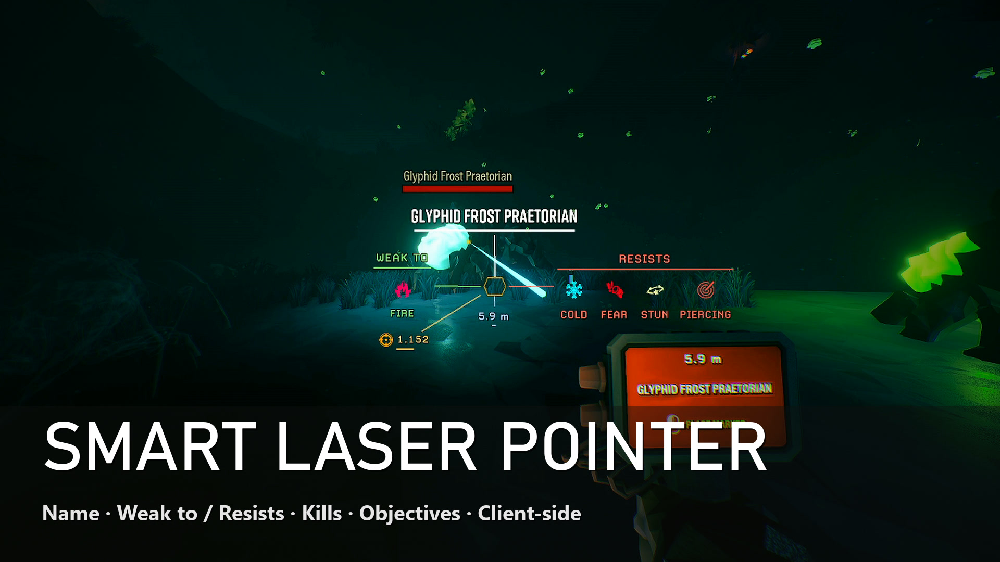
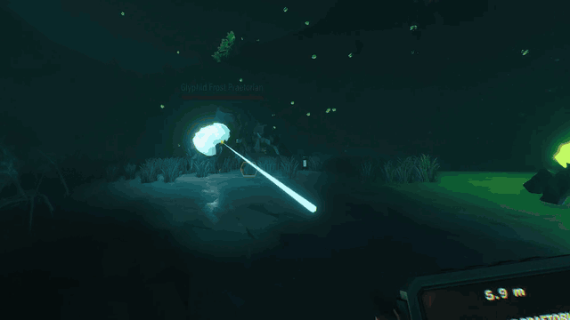
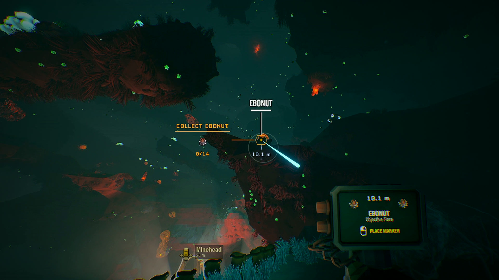
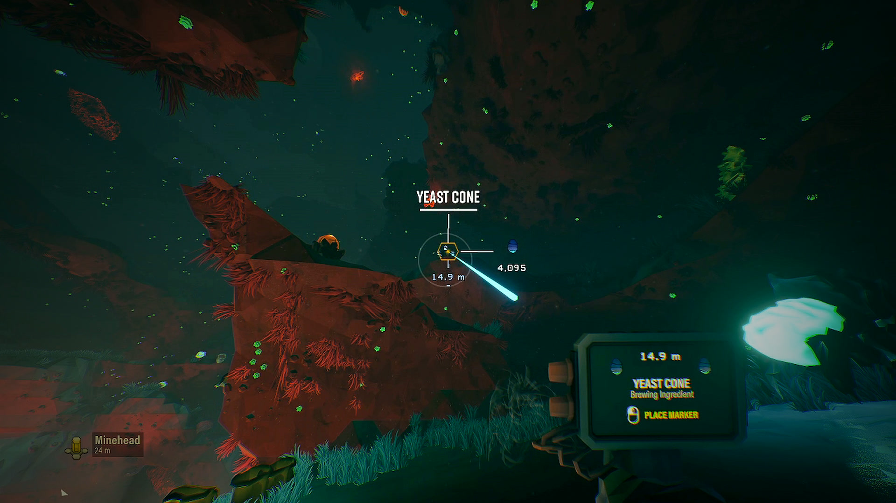
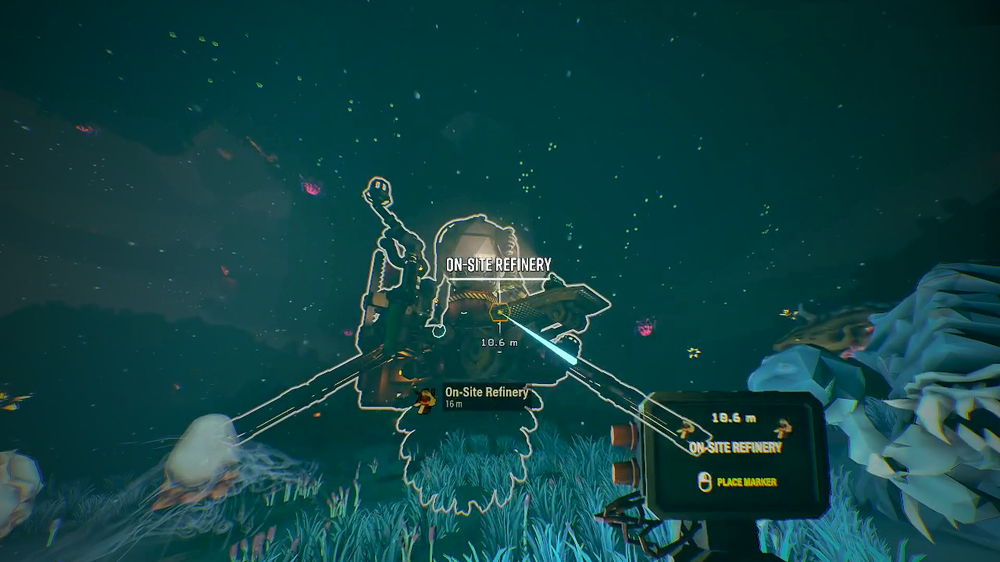

# Smart Laser Pointer

[](https://github.com/byrodi/smart-laser-pointer-drg/releases/latest)
[](LICENSE)

Deep Rock Galactic mod: the laser pointer tells you what a thing is and what it is for.



Rest the laser pointer on a creature, a mineral or a machine. A hexagon closes on it, and what the game knows
about it comes out of the hexagon, each fact on its own line. It helps new players learn what things are and
reminds veterans why they matter.



## Features

The bar under each element tells how much it matters: the longer, the more.

- **Name** above the target, over a long white bar, as the laser pointer's own screen writes it.
- **Creatures:** WEAK TO on the left (green) and RESISTS on the right (red), each heading over the game's damage
  type icons and names. Only for creatures your Miner's Manual already shows (killed at least once).
- **Resources** (veins, gems, chunks, collectibles, brewing ingredients): the objective it counts for on the left,
  with the objective's own text, icon and counter (green once done); how much of it you own on the right (forge
  minerals, brewing ingredients).
- **Machines and other named things:** the objective whose text names them.
- **Distance** right under the target in a soft blue, with a short tick. It follows the pointer.
- **Kill count** of a creature under WEAK TO, in a soft gold, next to the Miner's Manual's crosshair.
- Nothing for plain rock, dirt or ice, or for other dwarves.
- No backgrounds: outlined text, each element tied to the hexagon by a thin line in its colour.
- Sweeping the pointer shows nothing: the scan comes out after the pointer rests on a target for a moment
  (0.14 s), dims when it leaves and fades shortly after (0.45 s).
- All names, damage types and objective texts come from the game while you play, so game updates and the game's
  language carry over by themselves. The only words the mod writes itself are WEAK TO and RESISTS.
- Client-side: other players do not need the mod. Works as host and as client.







## Settings

With [Mod Hub](https://mod.io/g/drg/m/mod-hub), the Smart Laser Pointer page has **Enabled** on top. While it is
on, **DETAILED SETTINGS** opens a list with one switch per element:

| Group | Setting | Default |
| --- | --- | --- |
| Every target | Name, Distance | on |
| Creatures | Weak to and resists, Kill count | on |
| Resources and objectives | Objective, Owned amount | on |

Changes show at once. Without Mod Hub everything is on.

## Fair play

Smart Laser Pointer changes nothing in the game. It shows only what the game already shows you elsewhere:

- the laser pointer's own screen: the name and the distance;
- the Miner's Manual: creature weaknesses and resistances (as the manual unlocks them), your kill counts;
- the objectives box: the objective's text, counter and icon;
- your own resource counts, as the Space Rig shows them.

No health values, no enemy counts, nothing through walls, no markers, no sounds, nothing sent over the network.

## Performance

Nothing runs while the laser pointer is put away. With the pointer out, the mod reads the pointer's own hit result
once per frame (the game works it out anyway for the pointer's screen), sorts a new target once, and fills the
scan once per target. Only the elements on screen move; the others cost nothing. The game's resource lists are
read once per level and the icons load in the background; nothing scans the level, so joining a mission late does
not hitch.

## Installation

Subscribe on [mod.io](https://mod.io/g/drg/m/smart-laser-pointer), or by hand:

1. Download `smart-laser-pointer.pak` from the [latest release](https://github.com/byrodi/smart-laser-pointer-drg/releases/latest).
2. Add it to [mint](https://github.com/trumank/mint) as a local mod and install the profile.
3. Start the game. With [Mod Hub](https://mod.io/g/drg/m/mod-hub) installed, the settings are on the "Smart Laser
   Pointer" page.

## Compatibility

- [Mod Hub](https://mod.io/g/drg/m/mod-hub) for the settings page (optional).
- [Dwarf Builds](https://mod.io/g/drg/m/dwarf-builds) scans dwarves with the laser pointer; Smart Laser Pointer
  leaves dwarves to it, so both work together.

## Build from source

The mod is built with the drg-toolkit workspace (an Unreal Engine 4.27 project with the BPForge plugin):

```
drg build smart-laser-pointer --save   # Blueprints from Tools/smart_laser_pointer_spec.py into Content/_SmartLaserPointer
drg pack smart-laser-pointer           # cook and pack smart-laser-pointer.pak
drg install smart-laser-pointer        # local test with mint
```

`Tools/hexscan.py` is the scan's look and motion (the hexagon, the stations around it, the spring, the lines);
`Tools/smart_laser_pointer_spec.py` decides what each station shows.

## License

[MIT](LICENSE)
